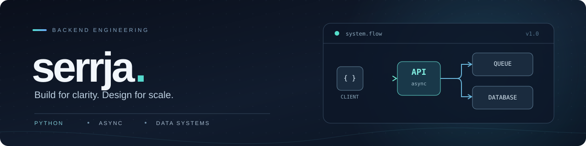

### 👋 Python Backend Developer

**3+ years building APIs, integrations, and asynchronous services.**  
I turn complex workflows into reliable, maintainable backend systems.

 

### 🧑‍💻 A little about me

- ⚙️ I work on **REST APIs, gRPC services, WebSockets**, and event-driven integrations.
- 🚀 I care about **performance** — from efficient SQL queries to async processing and caching.
- 🛡️ I value **reliability** — tests, observability, predictable retries, and clear system boundaries.
- 🧩 I also explore **Python + C++** and build my own developer tools.

### 🛠️ Tech stack

 

| Area | Tools & technologies |
| :--- | :--- |
| **Backend** | Python · FastAPI · asyncio · SQLAlchemy · Pydantic |
| **Data & messaging** | PostgreSQL · Redis · RabbitMQ · Alembic |
| **APIs** | REST · gRPC · WebSockets · OpenAPI |
| **DevOps & quality** | Docker · Linux · pytest · CI/CD · Prometheus · Grafana |

### ⚡ Selected results

- **~1.1s → ~250ms** average API response time after moving webhook handling to asynchronous processing.
- **8–9min → 2–3min** to process a batch of ~5,000 records through SQL and write-path optimization.
- **3–5× lower p95 latency** on selected endpoints through query tuning and Redis caching.

---

Simple interfaces. Predictable systems. Solid engineering.

