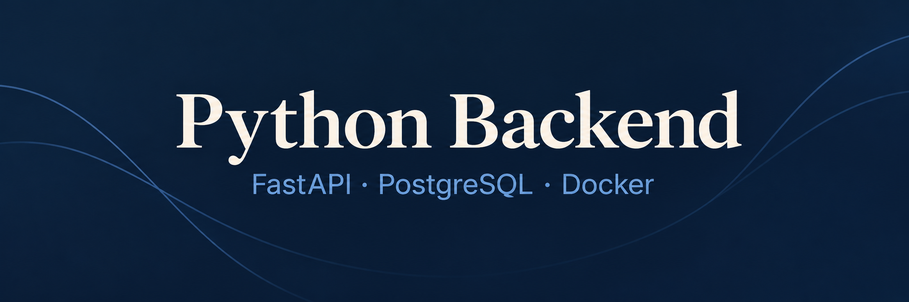

# Python Backend Developer

I build Python APIs and asynchronous services with FastAPI and PostgreSQL.
I focus on explicit data boundaries, reliable processing, database performance and automated tests.

| Area | Tools |
| --- | --- |
| Backend | Python · FastAPI · asyncio · Pydantic · SQLAlchemy · Alembic |
| Data and messaging | PostgreSQL · Redis · RabbitMQ |
| Engineering | Docker · pytest · Git · CI/CD · Prometheus · Grafana |
| Engine work | C++20 rules engine with Python bindings |

## Projects and public material

- **[Pokerlost](https://github.com/pokerlost)** — an evolving poker platform: C++ rules engine,
  Python SDK and shared Flutter web UI. Code is private; the public organization page explains
  the scope. Foundations and demos are in development.
  [Read the actual engine demo recording](docs/engine_demo.md).
- **[baseRules](https://github.com/serrja/baseRules)** — reusable engineering and documentation
  conventions, plus portable Obsidian templates with placeholders.
- **[Pokerlost project rules](https://github.com/pokerlost/projectRules)** — safe public project
  conventions and pinned baseRules provenance.

I also maintain private Copier foundations for Python libraries, Typer applications and FastAPI
services, with locked Docker checks and actual template-update tests. Their source is private.

[Public repositories](https://github.com/serrja?tab=repositories) ·
[Pokerlost overview](https://github.com/pokerlost) · [MIT license](LICENSE)
