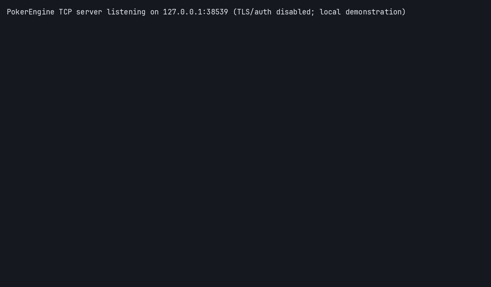

# Pokerlost engine demo

A real synthetic two-player hand ran through the installed public Python API and a
loopback TCP server. C++20 owns validation, state and settlement; Python handles
transport, input and display. This recording is from source `ea1b4177bb7b2f0c46c775f4e34f6941e6affec8`.
The implementation repository is private. These captured outputs are public.

## Current dev recording



[Connection](../assets/engine_demo/c23d9419f16ba52a239d994720b730293dacc640/connected.png) ·
[Flop](../assets/engine_demo/c23d9419f16ba52a239d994720b730293dacc640/flop.png) ·
[Showdown](../assets/engine_demo/c23d9419f16ba52a239d994720b730293dacc640/result.png) ·
[Original cast](../assets/engine_demo/c23d9419f16ba52a239d994720b730293dacc640/demo.cast) ·
[Source receipt](../assets/engine_demo/c23d9419f16ba52a239d994720b730293dacc640/source.json).

Source `c23d9419f16ba52a239d994720b730293dacc640`, wheel `2.0.0.dev1`. The actual server and two
console clients completed preflop, flop, turn, river and settlement: Bob received
200 synthetic chips, zero rake. Private card views were disabled. Images are faithful
replay frames from actual terminal output, not a graphical game client or invented
transcript. The older run below retains its original SHA and distinct outcome.

From the private engine checkout with its prepared wheel environment, `make demo`
runs the scenario and stops only its own children. The engine's
`examples/render_demo.py` converts the retained cast using Pillow and a local
monospace font; no font binary is published here.

Validation for this dev snapshot: lint passed and this local demo completed.
Full suites, coverage, integration and production deployment were not run. These
changes live on dev; the default-branch profile is unchanged until promotion.

## Historical capture

- [Alice console](../assets/engine_demo/ea1b4177bb7b2f0c46c775f4e34f6941e6affec8/alice.txt), [Bob console](../assets/engine_demo/ea1b4177bb7b2f0c46c775f4e34f6941e6affec8/bob.txt),
  [server console](../assets/engine_demo/ea1b4177bb7b2f0c46c775f4e34f6941e6affec8/server.txt).
- [Provenance and file checksums](../assets/engine_demo/ea1b4177bb7b2f0c46c775f4e34f6941e6affec8/provenance.json).

Plain logs only remove ANSI control sequences and normalize line endings from the
original terminal recording. They contain synthetic public views, with hole cards
hidden. No generated terminal picture or invented transcript is used.

The run joined two players, started a hand, rejected an illegal check and an
out-of-turn action without advancing state, then completed an all-in/call and
native settlement. Bob received 2000 synthetic chips; rake was zero. This is one
recorded functional scenario, not a performance or production claim.

## Replay

From a checkout of this profile repository on a system with util-linux:

```bash
scriptreplay --log-timing assets/engine_demo/ea1b4177bb7b2f0c46c775f4e34f6941e6affec8/alice.timing --log-out assets/engine_demo/ea1b4177bb7b2f0c46c775f4e34f6941e6affec8/alice.typescript --divisor 0.1
```

Original recordings: [Alice](../assets/engine_demo/ea1b4177bb7b2f0c46c775f4e34f6941e6affec8/alice.typescript) / [timing](../assets/engine_demo/ea1b4177bb7b2f0c46c775f4e34f6941e6affec8/alice.timing),
[Bob](../assets/engine_demo/ea1b4177bb7b2f0c46c775f4e34f6941e6affec8/bob.typescript) / [timing](../assets/engine_demo/ea1b4177bb7b2f0c46c775f4e34f6941e6affec8/bob.timing),
[server](../assets/engine_demo/ea1b4177bb7b2f0c46c775f4e34f6941e6affec8/server.typescript) / [timing](../assets/engine_demo/ea1b4177bb7b2f0c46c775f4e34f6941e6affec8/server.timing).

The private demo provides headless/interactive server modes and two console
clients. Its controls include state, legal actions, fold/check/call/bet/raise,
all-in, settle, result, events and quit. The captured wheel was built from the same
clean source commit and imported from site-packages. At that historical source, the owner suite passed 201
Python tests and native C++ suites; the actual recording also checked privacy,
illegal-action atomicity and clean disconnect.

There is no network authentication or TLS in this local example: use loopback or
an isolated test network. Multiplayer platform orchestration, accounts, ledger and
payments remain in development. Source access and publication are separate owner
decisions. See the [public project overview](https://github.com/pokerlost).

[Back to the profile](../README.md).
